# Host Gene Expression Response to Varicella Zoster Virus (Chickenpox): Interferon Related Genes and Pathways

A bioinformatics reanalysis of the public GEO dataset **GSE121385** using R (dplyr, ggplot2 and clusterProfiler).

## 1. Introduction

**Chickenpox (varicella)** is a highly contagious disease caused by the **Varicella-Zoster Virus (VZV)**, a member of the *Herpesviridae* family. After the first infection the virus stays latent in nerve cells and can reactivate years later as **shingles (herpes zoster)**. When human cells are infected, they switch on antiviral and immune genes, especially those of the interferon response.

This project analyses five publicly available VZV-related host gene expression tables from the Gene Expression Omnibus (GEO). The workflow covers data import, quality checks, identification of significant genes, comparison of genes across datasets, gene frequency analysis, Gene Ontology (GO) enrichment, KEGG pathway enrichment and an automatically generated summary report.

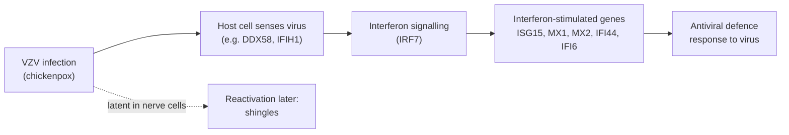

## 2. Research Objectives

- Import and examine five VZV-related host gene expression datasets.
- Assess data quality (missing values, duplicate genes, empty gene names).
- Identify significant genes in each dataset (q-value ≤ 0.05).
- Compare significant genes across the five datasets and find common genes.
- Identify frequently occurring ("important") genes found in at least four datasets.
- Identify enriched biological processes (GO) and pathways (KEGG).
- Summarise the findings in figures, tables and a final report.

## 3. Dataset

| Item | Detail |
|---|---|
| Accession | [GSE121385](https://www.ncbi.nlm.nih.gov/geo/query/acc.cgi?acc=GSE121385) |
| Source | NCBI Gene Expression Omnibus (GEO) |
| Organism | *Homo sapiens* (host cells) |
| Comparison | Mock-infected vs. VZV-related conditions |
| Format | Five Excel tables, one per condition |
| Samples used | GSM3433679 to GSM3433683 |

| Dataset label | GEO sample | Condition | Rows |
|---|---|---|---:|
| YC01_Low | GSM3433679 | YC01 Low | 43 |
| YC01_High | GSM3433680 | YC01 High | 202 |
| Suduvax_CA | GSM3433681 | Suduvax CA (vaccine strain) | 218 |
| Suduvax_CF | GSM3433682 | Suduvax CF (vaccine strain) | 218 |
| VarilRix | GSM3433683 | VarilRix (vaccine strain) | 103 |

Columns used: `GeneName`, `log2fc`, `p-value`, `q-value` and `DEG:UP_DOWN`. The supplied tables were analysed as provided; no new normalisation or differential expression testing was done in this project.

## 4. Methodology

All analyses were done in R / RStudio.

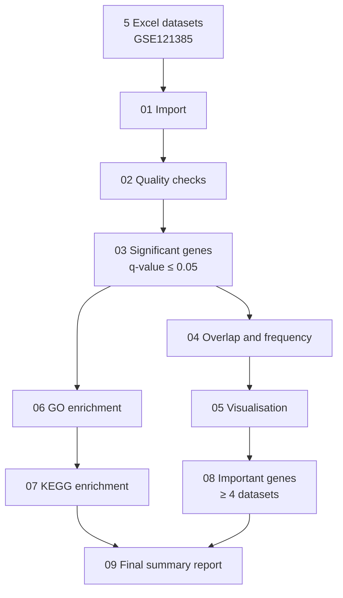

### 4.1 Data import (`01_data_import.R`)
The five Excel files in `data/` were read with `readxl` and stored as a named list (`imported_datasets.rds`).

### 4.2 Exploration and quality checks (`02_data_exploration_and_quality.R`)
Dimensions, column names, structure, numeric summaries, missing values, duplicated gene names, the number of significant rows by q-value and p-value, and the up/down labels were checked for every dataset.

### 4.3 Significant genes (`03_significant_gene_analysis.R`)
Gene names were trimmed and empty names removed. A gene was called **significant** if `q-value ≤ 0.05`. Counts are **unique gene symbols**, not table rows, so genes that appear several times are counted once. Percentage = unique significant genes ÷ unique genes × 100. Genes were then counted by how many datasets they were significant in, and genes significant in at least four datasets were labelled **important**.

### 4.4 Overlap and frequency (`04_Gene_Overlap_and_Frequency_Analysis.R`)
Genes significant in all five datasets were found with `Reduce(intersect, ...)`. A separate frequency table counts how many datasets each gene appears in at all (significant or not).

### 4.5 Visualisation (`05_Gene_Visualization.R`)
Bar charts of the significant gene percentages and of the frequency of each significant gene. The frequency chart is split into two panels for readability.

### 4.6 GO enrichment (`06_GO_Enrichment_Analysis.R`)
Gene symbols were converted to Entrez IDs with `bitr()` (`org.Hs.eg.db`) and duplicate IDs removed. `enrichGO` (clusterProfiler) was run on the Biological Process ontology with Benjamini-Hochberg adjustment, adjusted p < 0.05 and q < 0.20. The default **whole-genome background** was used.

### 4.7 KEGG enrichment (`07_KEGG_Pathway_Enrichment_Analysis.R`)
`enrichKEGG` (organism `hsa`), same cut-offs as GO. This step queries the KEGG online database.

### 4.8 Important genes (`08_Important_Significant_Gene_Analysis.R`)
The 13 genes found in at least four datasets were sorted by frequency and plotted.

### 4.9 Final summary (`09_Final_Project_Summary.R`)
Collects the main numbers, genes and top GO/KEGG terms into `report/final_project_summary.txt`.

## 5. Results

### 5.1 Data quality

- **YC01_Low, YC01_High and VarilRix** have valid gene names in every row. VarilRix has 103 rows but only 90 unique genes.
- **Suduvax_CA and Suduvax_CF** have 150 and 151 rows (of 218) with no gene name. These rows were excluded, leaving 68 and 67 unique genes.
- Every gene entry in all five tables is labelled `UP` in `DEG:UP_DOWN`. The tables therefore contain upregulated genes only.

### 5.2 Significant genes per dataset

| Dataset | Significant unique genes | Total unique genes | Percentage |
|---|---:|---:|---:|
| YC01_Low | 7 | 43 | 16.28% |
| YC01_High | 18 | 202 | 8.91% |
| Suduvax_CA | 31 | 68 | 45.59% |
| Suduvax_CF | 34 | 67 | 50.75% |
| VarilRix | 40 | 90 | 44.44% |

A total of **53 unique genes** were significant in at least one dataset. The Suduvax and VarilRix datasets have a much higher share of significant genes than the YC01 datasets, but each table has a different size and the tables list upregulated genes only, so these percentages should not be read as infection severity or vaccine effectiveness.

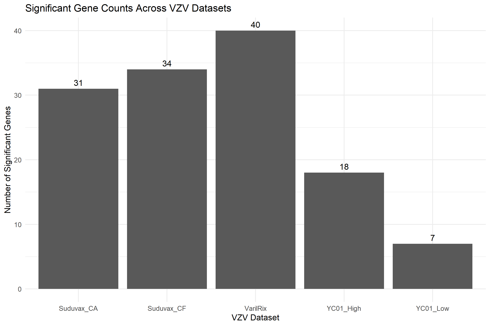

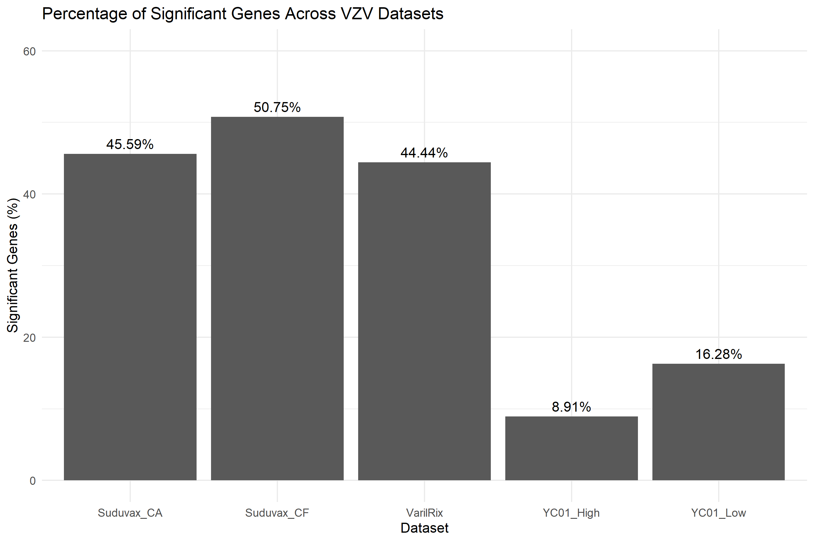

### 5.3 Common and important genes

- **Significant in all 5 datasets (3):** `MX1`, `ISG15`, `MX2`
- **Significant in at least 4 datasets (13):** `ISG15`, `MX1`, `MX2`, `CFB`, `CMPK2`, `HERC6`, `IFI27`, `IFI44`, `IFI44L`, `IFI6`, `IRF7`, `ISG20`, `LGALS9`

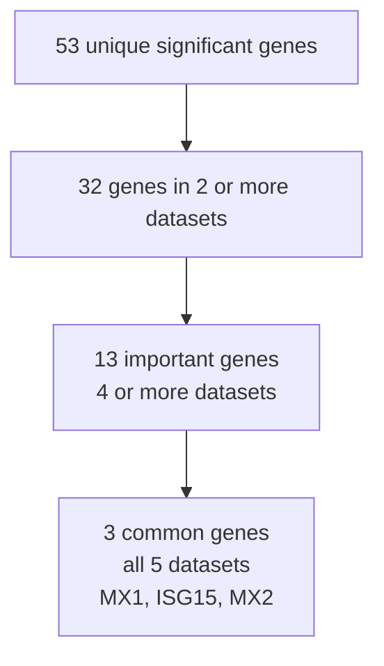

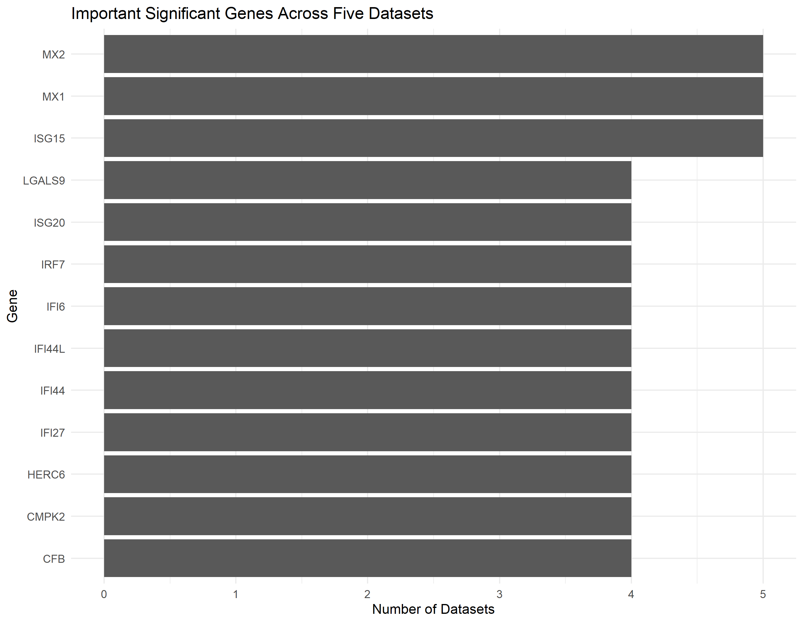

### 5.4 Gene frequency across datasets

Of the 53 significant genes, 3 occur in five datasets, 10 in four, 16 in three, 3 in two and 21 in only one dataset.

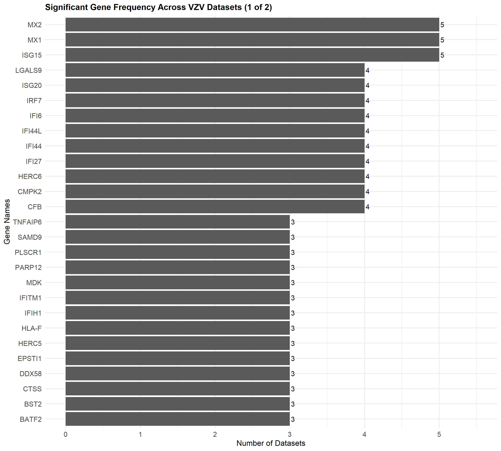

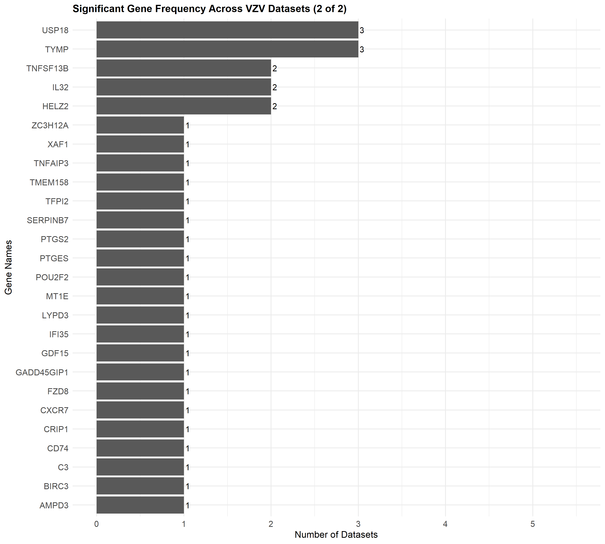

The chart below counts how often any gene (significant or not) appears across the five tables, so it is not limited to significant genes.

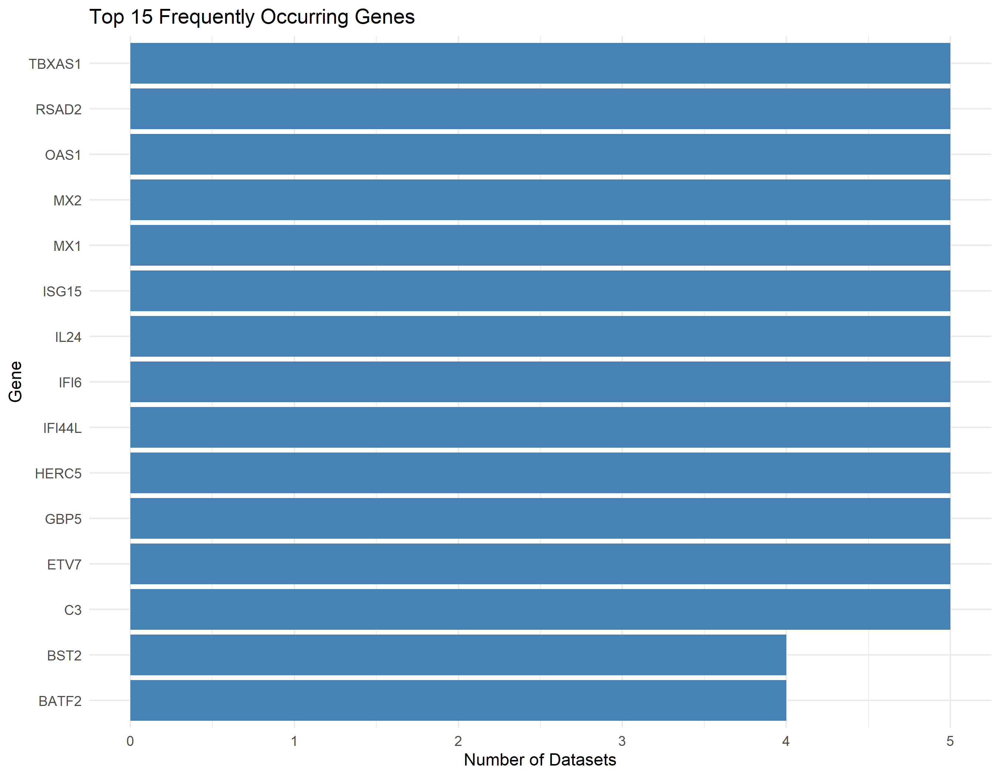

### 5.5 GO Biological Process enrichment

51 of the 53 significant gene symbols mapped to unique Entrez IDs, and 49 of these had GO annotations. GO enrichment gave **263 significant terms** (all with adjusted p < 0.05). The strongest terms are:

| GO term | Gene ratio | Adjusted p |
|---|---|---:|
| response to virus | 19/49 | 1.5e-16 |
| defense response to virus | 16/49 | 2.1e-14 |
| regulation of viral life cycle | 9/49 | 4.4e-09 |
| negative regulation of viral process | 8/49 | 5.3e-09 |
| negative regulation of viral genome replication | 7/49 | 9.7e-09 |

Many of the 263 terms relate to interferon, for example *response to type I interferon*, *response to interferon-beta* and *type I interferon-mediated signaling pathway*.

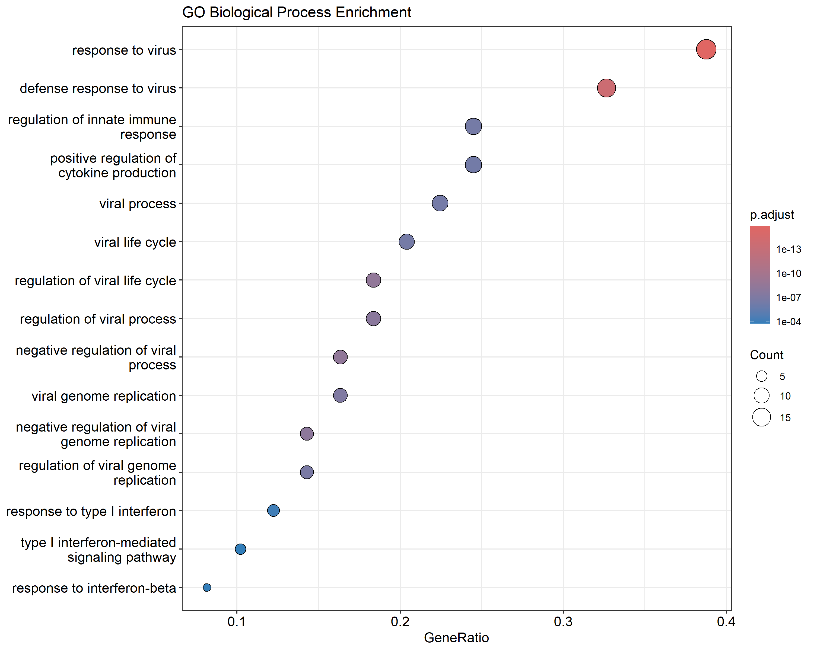

### 5.6 KEGG pathway enrichment

27 genes had KEGG annotations. **13 pathways** were significant (adjusted p < 0.05):

| KEGG pathway | Gene ratio | Adjusted p |
|---|---|---:|
| Herpes simplex virus 1 infection | 8/27 | 2.0e-06 |
| Measles | 5/27 | 0.0015 |
| Coronavirus disease | 6/27 | 0.0015 |
| NF-kappa B signaling pathway | 4/27 | 0.0049 |
| Human papillomavirus infection | 6/27 | 0.0054 |
| RIG-I-like receptor signaling pathway | 3/27 | 0.015 |
| Viral life cycle - HIV-1 | 3/27 | 0.015 |
| Influenza A | 4/27 | 0.016 |
| Antigen processing and presentation | 3/27 | 0.017 |
| Nucleotide metabolism | 3/27 | 0.017 |
| Kaposi sarcoma-associated herpesvirus infection | 4/27 | 0.019 |
| Epstein-Barr virus infection | 4/27 | 0.020 |
| TNF signaling pathway | 3/27 | 0.033 |

The virus-named pathways (for example Measles or Coronavirus disease) do not mean these infections are present. They share the same interferon and antiviral genes that respond to VZV.

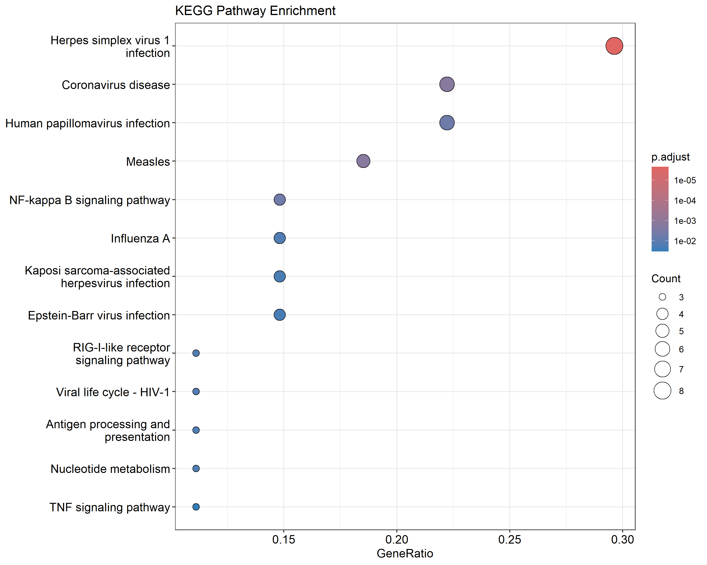

## 6. Discussion

Across all five datasets, three genes (`MX1`, `ISG15`, `MX2`) were significant every time, and ten more were significant in four of five. Most of these are well-known **interferon-stimulated genes** involved in antiviral defence. GO and KEGG enrichment agree with this: the strongest terms are *response to virus*, *defense response to virus* and interferon signalling, and the pathways include RIG-I-like receptor and NF-kappa B signalling, which are part of innate antiviral sensing.

Some caution is needed:

- GO and KEGG enrichment show **over-representation** of annotations among the input genes. They do not show whether a process is switched on or off.
- With only 51 input genes, and because the input is a list of upregulated genes, enrichment results are descriptive, not conclusive.
- The same shared interferon genes drive many virus-named KEGG pathways, so the 13 pathways are not independent findings.
- The enrichment used the default whole-genome background rather than only the genes detected in these experiments, which can make significance look stronger than it is.

## 7. Limitations

1. **Pre-processed input:** the supplied tables were used as provided, with no re-analysis from raw data.
2. **Upregulated genes only:** all rows are labelled `UP`, so downregulated genes cannot be examined.
3. **Different table sizes:** the tables have 43 to 218 rows, so percentages are not directly comparable across datasets.
4. **Missing gene names:** about two thirds of the rows in the two Suduvax tables have no gene name and were excluded.
5. **Significance threshold:** genes were called significant at q-value ≤ 0.05 with no fold-change cutoff.
6. **Enrichment background:** the default whole-genome background was used instead of a custom one.
7. **Small gene list:** 51 mapped genes limit the power and stability of the enrichment analysis.
8. **No validation:** results were not validated by qPCR or an independent dataset.
9. **Unused columns:** the Suduvax tables contain expression columns with inconsistent names (for example a `SuduVaxCA` column in the CF file). These columns were not used in this analysis.

## 8. Conclusion

Using GSE121385, this project found 53 unique significant host genes across five VZV-related datasets. Three genes (`MX1`, `ISG15`, `MX2`) were significant in all five, and 13 genes in at least four, mostly interferon-stimulated antiviral genes. GO enrichment identified 263 biological process terms, led by *response to virus* and *defense response to virus*, and KEGG identified 13 pathways, including RIG-I-like receptor and NF-kappa B signalling. Together the results point to a consistent host interferon and antiviral response to VZV, to be interpreted with caution given the pre-processed, upregulated-only input and the small gene list.

## 9. Tools

| Tool | Use |
|---|---|
| R, RStudio | Analysis environment |
| readxl | Importing Excel data |
| dplyr | Data handling |
| ggplot2 | Plots |
| clusterProfiler, enrichplot, DOSE, GO.db | GO / KEGG enrichment and plots |
| org.Hs.eg.db | Human gene annotation and ID mapping |
| Git / GitHub | Version control |

## 10. Repository Structure

```text
Bioinformatics/
├── code/
│   ├── 01_data_import.R
│   ├── 02_data_exploration_and_quality.R
│   ├── 03_significant_gene_analysis.R
│   ├── 04_Gene_Overlap_and_Frequency_Analysis.R
│   ├── 05_Gene_Visualization.R
│   ├── 06_GO_Enrichment_Analysis.R
│   ├── 07_KEGG_Pathway_Enrichment_Analysis.R
│   ├── 08_Important_Significant_Gene_Analysis.R
│   └── 09_Final_Project_Summary.R
├── data/               # 5 GSE121385 Excel tables (GSM3433679 to GSM3433683)
├── results/            # CSV tables and 8 PNG figures shown above
├── report/
│   └── final_project_summary.txt
├── .gitignore
└── README.md
```
## 11. References

1. Gene Expression Omnibus (GEO), dataset GSE121385. NCBI. https://www.ncbi.nlm.nih.gov/geo/query/acc.cgi?acc=GSE121385
2. Yu G, Wang LG, Han Y, He QY (2012). clusterProfiler: an R package for comparing biological themes among gene clusters. *OMICS*, 16(5), 284-287.
3. Wu T, et al. (2021). clusterProfiler 4.0: A universal enrichment tool for interpreting omics data. *The Innovation*, 2(3), 100141.
4. Gene Ontology Consortium. The Gene Ontology resource. http://geneontology.org
5. Kanehisa M, Goto S (2000). KEGG: Kyoto Encyclopedia of Genes and Genomes. *Nucleic Acids Research*, 28(1), 27-30.

## 13. Author

**Epziba Kulasekaram**  
BSc (Hons) in Computer Science, Faculty of Applied Science, University of Vavuniya, Sri Lanka  
GitHub: https://github.com/Epziba20021/2021-ASP-39
